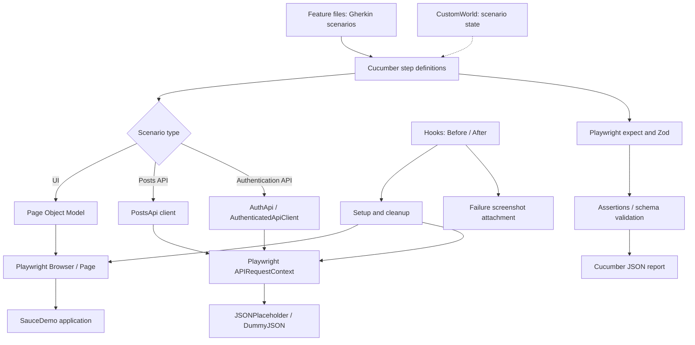
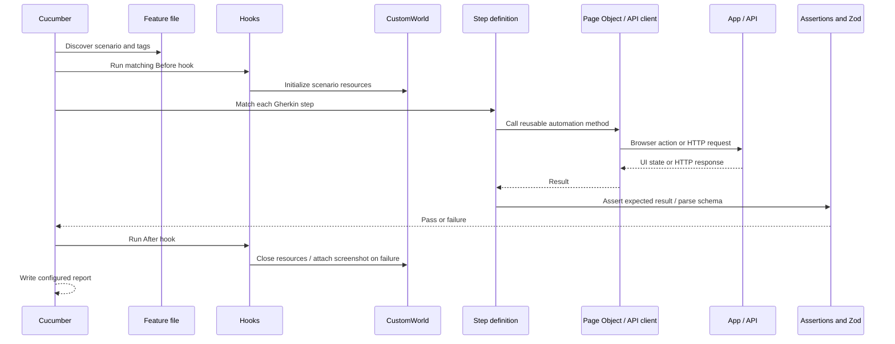
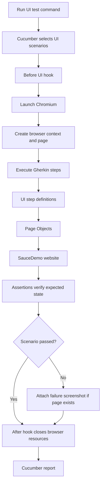
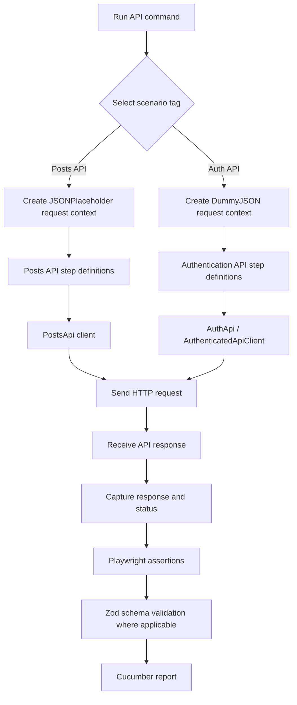
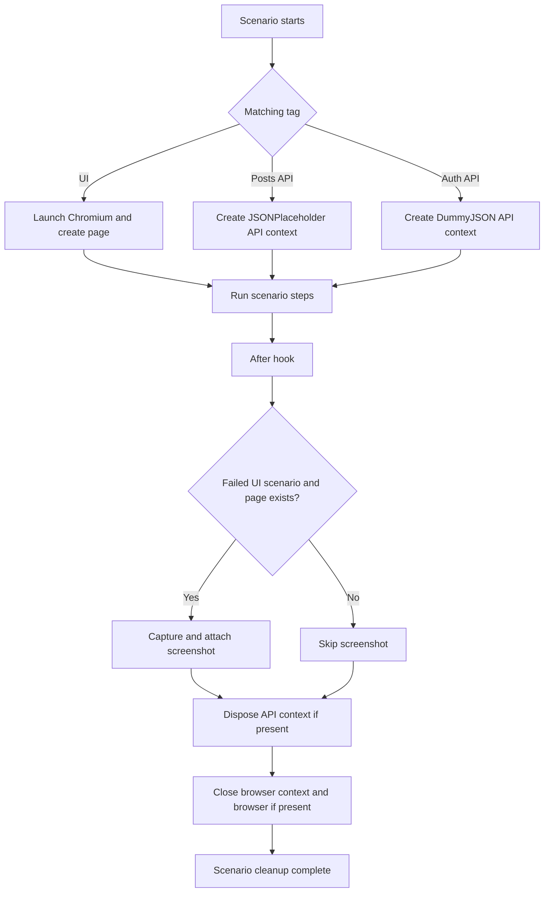
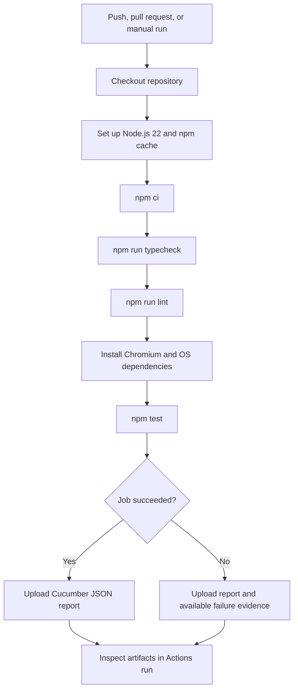

# SauceDemo Playwright + Cucumber BDD Framework

A practical, TypeScript-based test automation framework combining ****Cucumber (Gherkin BDD)**** and ****Playwright****. It automates SauceDemo UI journeys and practice REST API scenarios while reusing Page Objects and API clients instead of putting automation logic directly into Gherkin step definitions.

This README is designed as an implementation guide: it explains the architecture, shows the execution flow, documents setup and commands, and includes diagrams that can be rendered by GitHub.

---

## Contents

1\. [What this framework covers](#what-this-framework-covers)
2\. [High-level architecture](#high-level-architecture)
3\. [Repository structure](#repository-structure)
4\. [How a scenario executes](#how-a-scenario-executes)
5\. [UI automation flow](#ui-automation-flow)
6\. [API automation flow](#api-automation-flow)
7\. [Hooks and scenario lifecycle](#hooks-and-scenario-lifecycle)
8\. [Setup](#setup)
9\. [Credentials and environment variables](#credentials-and-environment-variables)
10\. [Commands and tags](#commands-and-tags)
11\. [GitHub Actions CI/CD](#github-actions-cicd)
12\. [Reports and troubleshooting](#reports-and-troubleshooting)
13\. [Validation status](#validation-status)
14\. [How to extend the framework](#how-to-extend-the-framework)

## What this framework covers

A practical, TypeScript-based test automation framework combining **Cucumber (Gherkin BDD)** and **Playwright**. It automates SauceDemo UI journeys and practice REST API scenarios while reusing Page Objects and API clients instead of putting automation logic directly into Gherkin step definitions.

| Area | Coverage | Scenarios |
|---|---|---:|
| SauceDemo UI | Login, inventory/product details, sorting, cart, checkout | 16 |
| Posts API | GET, filtering, POST, PUT, PATCH, DELETE, schema validation and negative cases | 8 |
| Authentication API | Protected access, missing/invalid token, token reuse and refresh | 5 |
| **Total** | **Distinct authored Gherkin scenarios** | **29** |

The count is the number of authored scenarios, not the number of browser launches. The current Cucumber hooks launch Chromium for UI scenarios. The legacy Playwright Test specs and `playwright.config.ts` are retained for optional reference/execution using `npm run test:legacy`.

## High-level architecture

The framework separates business-readable scenarios from reusable automation logic.



### Main responsibilities

| Component | Responsibility | Keep it focused on |
|---|---|---|
| `.feature` files | Describe expected behaviour in Gherkin | Business-readable Given/When/Then steps |
| Step definitions | Translate Gherkin steps into automation calls | Orchestration, not large chunks of UI/API logic |
| Page Objects (`pages/`) | Encapsulate UI locators and actions | UI-specific behaviour |
| API clients (`api/`) | Encapsulate HTTP calls and payload handling | API-specific behaviour |
| `CustomWorld` | Store objects and data for one scenario | Scenario state; avoid sharing mutable state across scenarios |
| Hooks (`features/support/hooks.ts`) | Create/clean resources and handle failures | Setup, teardown and attachments |
| Zod schemas | Validate API response shapes | Explicit structure checks |
| GitHub Actions | Run checks and tests in CI | Reproducible validation and artifacts |

## Repository structure

```text

repository-root/

├── .github/
│   └── workflows/
│       └── \<workflow-file>.yml    # GitHub Actions pipeline
├── api/
│   ├── PostsApi.ts                # JSONPlaceholder posts endpoints
│   ├── AuthApi.ts                 # DummyJSON authentication/token operations
│   └── AuthenticatedApiClient.ts  # Authenticated requests and retry policy
├── features/
│   ├── ui/
│   │   ├── login.feature
│   │   ├── inventory.feature
│   │   ├── cart.feature
│   │   └── checkout.feature
│   ├── api/
│   │   ├── posts.feature
│   │   └── authentication.feature
│   ├── step-definitions/
│   │   ├── ui.steps.ts
│   │   └── api.steps.ts
│   └── support/
│       ├── world.ts               # CustomWorld: scenario-specific state
│       └── hooks.ts               # Before/After hooks
├── pages/                         # Login, inventory, product, cart, checkout pages
├── tests/                         # Retained legacy Playwright Test specs
├── playwright.config.ts           # Retained legacy Playwright configuration
├── cucumber.js                     # Cucumber support files, paths and report config
├── package.json                    # Scripts and dependencies
├── package-lock.json               # Reproducible dependency tree
├── .env.example                    # Credential template; safe to commit
├── .gitignore                      # Excludes .env, node_modules and test output
└── README.md

```

\> File names can differ slightly by repository version. Treat the actual files in the repository as authoritative.

## How a scenario executes



1\. Cucumber discovers `.feature` files using `cucumber.js`.

2\. Tags determine which scenarios are selected by a command such as `npm run test:ui`.

3\. A matching `Before` hook creates the browser page or API request context.

4\. Each step definition calls a Page Object or API client.

5\. Assertions verify status, content, UI state, or response schema.

6\. The `After` hook closes resources and attaches a screenshot if a UI scenario fails.

7\. Cucumber writes the configured JSON report.

## UI automation flow



Example feature:

```gherkin

@ui

Feature: SauceDemo login

Scenario: Standard user can log in

Given I am on the SauceDemo login page

When I log in as a standard user

Then I should see the inventory page

```

The exact step wording must match the step definitions already present in `features/step-definitions/ui.steps.ts`. The snippet illustrates the pattern; check your actual feature file before copying it.

### UI design rule

- Keep selectors and page interactions in `pages/`.

- Keep Gherkin readable and focused on behaviour.

- Keep step definitions small: call page methods and make scenario-level assertions.

- Use hooks for setup and cleanup, not for hiding business assertions.

## API automation flow



### API responsibilities

- `PostsApi` contains methods for reading, creating, replacing, patching and deleting posts.

- `AuthApi` handles authentication/token operations.

- `AuthenticatedApiClient` handles authenticated requests according to its implemented token/retry logic.

- `api.steps.ts` maps Gherkin steps to those clients and validates results.

- `APIRequestContext` is disposed during cleanup.

The API endpoints are practice/test services. Do not treat successful POST/PUT/PATCH responses from a mock API as proof of durable database persistence.

## Hooks and scenario lifecycle



`CustomWorld` holds per-scenario fields such as the browser, page, API request context, API clients, response and submitted payload. Scenario-specific state should not be moved to module-level mutable variables because that can cause leakage between scenarios, particularly if parallel execution is introduced later.

## Setup

### Prerequisites

- Node.js 22 (the CI workflow uses Node.js 22).

- npm.

- Git, if cloning the repository.

- Network access to install npm dependencies, browser binaries and access the sample applications/APIs.

### Install from a clean checkout

```bash

npm ci

npx playwright install chromium

```

On Linux CI, install the browser's system dependencies too:

```bash

npx playwright install --with-deps chromium

```

`npm ci` requires `package-lock.json` to exist and match `package.json`. If dependency definitions change, run `npm install`, review the lockfile change and commit both files.

## Credentials and environment variables

Copy `.env.example` to `.env` and set the credentials used for DummyJSON authentication scenarios:

```dotenv

AUTH_API_USERNAME=your_dummyjson_username

AUTH_API_PASSWORD=your_dummyjson_password

```

- Never commit `.env` or paste real credentials into source control.

- Keep `.env.example` with placeholder values only.

- In GitHub repository ****Settings → Secrets and variables → Actions****, add secrets named `AUTH_API_USERNAME` and `AUTH_API_PASSWORD`.

- The workflow passes these secrets to the job environment.

- SauceDemo's public sample-app credentials are used by UI scenarios and are separate from the DummyJSON API credentials.

## Commands

Run these from the repository root:

```bash

npm test                    # All Cucumber scenarios

npm run test:ui              # UI scenarios

npm run test:posts-api       # Posts API scenarios

npm run test:auth-api        # Authentication API scenarios (credentials required)

npm run test:api              # Both API feature groups

npm run test:headed           # UI scenarios with a visible browser

npm run typecheck             # TypeScript type check

npm run lint                 # ESLint

npm run test:legacy           # Original Playwright Test specs

```

Check `package.json` for the exact command definitions in your current checkout. The legacy command runs the old Playwright Test specs; the default `npm test` command runs Cucumber.

### Tag reference

| Tag | Purpose |
|---|---|
| `@ui` | Browser scenarios |
| `@authenticated` | Performs SauceDemo login in the matching setup hook |
| `@posts-api` | JSONPlaceholder API scenarios |
| `@auth-api` | DummyJSON authentication scenarios |

Examples:

```bash

npx cucumber-js --tags "@ui"

npx cucumber-js --tags "@posts-api"

npx cucumber-js --tags "@auth-api"

```

## GitHub Actions CI/CD

The workflow is configured to run for pushes to `main`, pull requests targeting `main`, and manual dispatch.



The workflow should:

1\. Install the exact dependency tree with `npm ci`.

2\. Fail early if TypeScript or ESLint checks fail.

3\. Install Chromium and its required system dependencies.

4\. Run the complete Cucumber suite.

5\. Upload `cucumber-report.json` and available failure evidence as artifacts.

Artifact uploads are best-effort if a path is absent. Confirm the actual report path in `cucumber.js` and the screenshot attachment behaviour in `features/support/hooks.ts`.

## Reports and troubleshooting

### Cucumber report

The current configuration writes `cucumber-report.json`. After a run, inspect the report locally or download the matching artifact from GitHub Actions.

### UI scenario fails

1\. Confirm Chromium is installed: `npx playwright install chromium`.

2\. Check the failure message and attached screenshot.

3\. Verify that the relevant Page Object locator still matches SauceDemo.

4\. Re-run only the UI scenarios: `npm run test:ui`.

### Authentication API scenario fails

1\. Confirm `.env` exists locally and contains the required variable names.

2\. Check that the credentials are valid for the configured DummyJSON service.

3\. Ensure GitHub repository secrets are configured for CI.

4\. Do not print credentials in logs or commit them.

### `npm ci` fails in CI

- Ensure `package-lock.json` is committed.

- Ensure the lockfile is synchronized with `package.json`.

- Regenerate it locally with `npm install`, then commit the reviewed changes.

### Cucumber reports zero scenarios

- Check the tag syntax in `package.json` scripts.

- Confirm the `.feature` files are under the paths configured in `cucumber.js`.

- Avoid passing feature paths redundantly if `cucumber.js` already specifies them.

## Validation status

The latest local validation shared for this framework reported:

- ****29 scenarios passed****

- ****107 steps passed****

- `npm run typecheck` passed

- `npm run lint` passed

These are local results. After pushing the current changes, check the GitHub Actions run separately to confirm CI dependencies, secrets, tests and artifact uploads work in the hosted environment.

## How to extend the framework

### Add a UI scenario

1\. Add a business-readable scenario to the appropriate file under `features/ui/`.

2\. Reuse existing step definitions where possible.

3\. If a new UI operation is needed, add a method to the relevant Page Object.

4\. Add or update a step definition that calls the Page Object.

5\. Run `npm run test:ui`, then `npm run typecheck`, `npm run lint` and `npm test`.

### Add an API scenario

1\. Add a scenario to `features/api/`.

2\. Reuse an existing API client method if possible.

3\. If the endpoint is new, add the HTTP operation to the appropriate API client.

4\. Add a step definition that calls the client and captures the response.

5\. Validate response content with Playwright assertions and Zod schemas where appropriate.

6\. Run the focused API command and then the full validation commands.

### Keep the design maintainable

- Feature files describe behaviour, not selectors or low-level request details.

- Page Objects own UI locators and interactions.

- API clients own endpoint calls and request construction.

- Step definitions connect Gherkin to reusable methods.

- Hooks manage lifecycle and cleanup.

- Schemas validate response structure.

- Add parallel execution only after verifying scenario isolation and safe resource handling.

- Add sharding only when suite size justifies explicit scenario partitioning; Cucumber does not automatically use Playwright Test's `--shard` option.

## License and sample-service note

This repository is an automation-learning and portfolio framework. SauceDemo, JSONPlaceholder and DummyJSON are external sample/demo services; their availability, behaviour and data are controlled by their respective providers.
